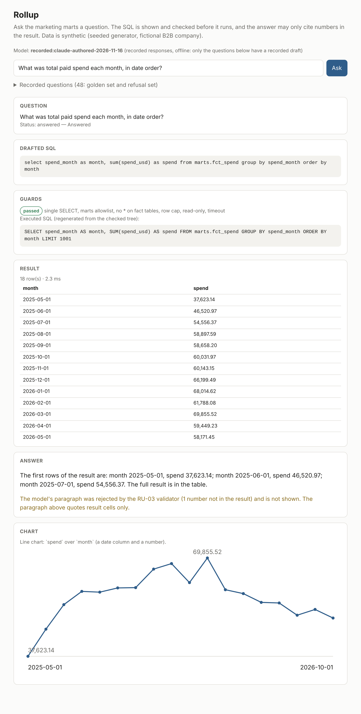

# Rollup

Marketing warehouse (dbt + DuckDB) with a safe text-to-SQL layer and a small query UI: ask a question, see the
SQL, see whether the safety checks passed, get the table, a chart, and an answer that cites only numbers in the
result.

Build-log #27. Status: **Phase 4 merged** (PR #6, 2026-11-18): FastAPI + HTMX query UI, shape-based charts and
this case study; review follow-up (PR #8) and the design pass (PR #9) merged 2026-11-19. All four PRD phases are on `main` (generator, dbt models, guards, guarded runner, model interface, RU-03
validator, golden-set eval, UI). Everything in CI runs on **recorded** model responses; no live LLM is
called by the build (D-29). Spec in `docs/PRD.md`, decisions in `docs/DECISIONS.md`, what's next in `NEXT.md`.

**All data is synthetic**: a seeded generator invents 18 months of a fictional B2B company's ad spend, web
sessions, form fills and CRM records. No client data, no real company.



The UI follows the Claude Design artboards in `docs/design/` (design pass, D-51..D-61): **Ask** (`/`), **How accurate is it?** (`/eval`, numbers from the committed run file) and **Data docs** (`/data`, the marts the model can see). `make a11y` runs axe-core against a running `make ui` (local; see `scripts/a11y_check.py`).

## Case study

### The problem

Marketing-ops teams answer the same questions every week: what did each channel spend, what did it source, what
does a customer cost. Text-to-SQL promises self-serve answers, but a language model left alone will happily write a
`DELETE`, read a table it shouldn't, or describe a result with a number the query never returned. The usual fix is
a prompt that asks nicely. Rollup puts the checks in code instead, and makes every step visible to the person
asking.

### Architecture

```
seeded generator (Python, Parquet)            rollup/generate.py, rollup/defects.py
        │  deliberately messy: UTM casing drift, duplicate leads, a timezone mismatch, a renamed campaign
        ▼
dbt-duckdb: staging → intermediate → marts    warehouse/
        │  identity stitching, campaign mapping, first/last-touch credit; dbt tests on every model, a custom
        │  test per injected defect, and mutation tests proving each custom test fails when its fix is removed
        ▼
question ──► model drafts one SELECT          rollup/llm.py (DraftModel: recorded | reference | live)
        │  context = the 7 marts' schema + column descriptions from the dbt manifest, nothing else
        ▼
guards (code, not prompt)                     rollup/guards.py, rollup/runner.py
        │  refuse, with a code and a reason ─────────────────────────────► refusal (no data numbers)
        ▼
read-only run, row cap, timeout
        ▼
answer paragraph ──► RU-03 validator          rollup/validator.py
        │  fails? the paragraph is dropped and replaced by one that quotes result cells
        ▼
UI: SQL → guard result → table → answer → chart     rollup/ui/ (FastAPI + HTMX, D-03)
```

The UI is a thin view over `rollup.ask.ask()`. It never runs SQL itself (`tests/test_ui.py` checks the module's
imports and calls), so it inherits every guard rather than reimplementing any.

### Guards

Every draft goes through `rollup.guards.check_sql` before DuckDB sees it, and the runner has no argument that skips
it:

- sqlglot parse; exactly one `SELECT` (or a set operation of SELECTs) with no DML/DDL/command node anywhere (RU-01)
- only the seven `marts` tables; CTE names resolved per scope; table functions, file paths, catalog qualifiers and
  system functions refused (RU-02)
- no `*` projection once a fact table is read; `COUNT(*)` is fine
- the outer `LIMIT` capped at 1000 rows
- a read-only connection with file access, extensions and settings locked, and a 5-second timeout

The executed SQL is regenerated from the checked syntax tree, so what runs is what was checked. The UI shows both
the drafted SQL and the executed SQL, and on a refusal shows the guard code (`not_select`, `table_not_allowed`,
`star_on_fact_table`, …) and its reason. Hypothesis property tests generate hostile SQL against RU-01/RU-02.

**RU-03 — the answer may cite only numbers in the result.** The validator extracts every number and date in the
paragraph and requires each to match a result cell at the precision written (rounding allowed, inventing not;
derived numbers such as sums fail by design, D-32). A failing paragraph is never shown, in the CLI or in the UI;
the UI does not even render the violation messages, because they quote the invented numbers (D-43). Charts follow
the same rule: every label in the SVG is a result cell, with no computed axis ticks, and a test runs the chart text
through the RU-03 validator (D-42).

### Eval method

40 golden questions across all seven marts, each with hand-written reference SQL (`rollup/eval/golden/`), plus 8
questions the marts cannot answer (`rollup/eval/refusals.json`). A golden question scores when the draft's result
set is **equivalent** to the reference result set (same rows as a multiset under a column mapping; row order only
for ordered questions; D-33). SQL text is never compared. A refusal-set question scores when no number is shown.

The recorded drafts (`rollup/eval/recorded.json`) were written in-session to exercise the pipeline, including
deliberately wrong-but-safe SQL, guard-violating SQL, erroring SQL and dishonest paragraphs (D-37). So the scores
below **measure the pipeline's behaviour on those drafts, not a model's skill**.

### Results (committed run files)

From [`docs/eval/recorded-run.json`](docs/eval/recorded-run.json) (recorded drafts, produced 2026-11-18 by
`make eval` on the seed-27 warehouse) and [`docs/eval/reference-run.json`](docs/eval/reference-run.json)
(`python -m rollup.eval.run --model reference`, the harness check):

| | Recorded drafts | Reference SQL (harness check) |
|---|---|---|
| Golden, result-set equivalent | 27/40 | 40/40 |
| Refusal set, no numbers shown | 7/8 | 8/8 |
| Drafts refused by a guard | 6 (4 golden, 2 refusal set) | 0 |
| Model paragraphs rejected by RU-03 (fallback shown) | 5 | n/a (reference writes no paragraph) |
| Invariant failures / DB file changed | 0 / no | 0 / no |

What the misses are: wrong-but-safe SQL that runs and returns the wrong rows (scored as a miss, not hidden), two
drafts DuckDB rejects, four drafts the guards refuse, one false refusal, and on the refusal set one confidently
wrong "churn" answer (`r04_churn`) that the pipeline cannot catch because its numbers *are* in its (wrong) result.
That last one is the honest limit of RU-03: it proves the paragraph matches the query, not that the query matches
the question. The equivalence score is what catches it.

### What is not verified

- **Live-model quality.** CI and these numbers use recorded drafts only. The owner ran the live adapter once on his
  own machine (reported below, run file not committed); nothing in this repo re-verifies that run, and D-39's fix
  for its one miss is untested against a live model.
- **The UI with a live model.** The UI has only been exercised on the recorded model. `make ui MODEL=live` exists
  for the owner's own key; it was not run in this build.
- **Numbers written as words** ("twelve percent") are not detected by RU-03 (known gap, D-32).
- **Scale and concurrency.** The UI is a local single-user tool: one read-only connection per request, no auth, no
  deployment. It binds to 127.0.0.1 by default.

## How to run it

```bash
pip install -e '.[dev]'
make build        # seeded synthetic data -> Parquet -> dbt build (models, data tests, unit tests)
make ui           # query UI on http://127.0.0.1:8000, recorded model, offline
make ask Q="Which five campaigns have the highest lifetime spend?"   # same pipeline, CLI
make eval         # golden-set eval on recorded drafts -> data/eval/run.json
make ci           # ruff, mypy, pytest, build, warehouse tests (incl. UI routes), eval, dbt docs, mutation tests
```

On the recorded model the UI answers the 48 recorded questions (listed under the input box); any other question
ends in "No usable draft". To use your own key: `pip install -e '.[live]'`, set `ANTHROPIC_API_KEY` and
`ROLLUP_LLM_MODEL`, then `make ui MODEL=live` (D-41). Other entry points: `make query Q="SELECT …"` runs hand-written
SQL through the same guards; `make queries` runs the 12 hand-written questions; `make docs` builds dbt docs.

### Charts

The chart is picked from the result's shape (D-42): a date column and a number → line (in date order); a text column
and a number with 2–30 distinct labels → bar (in result order); anything else — one row, no numeric column, NULLs,
repeated labels (several series), a result cut at the row cap — → table only, with the reason shown. Only the first
numeric column is charted.

## Owner-reported live run (not verified by this build)

One live run by the owner on 2026-11-16 (`claude-sonnet-5-5`, seed-27 warehouse, before D-38/D-39), as reported in
PR #5. The run file is not committed, so these figures are quoted, not reproduced:

| | Live run |
|---|---|
| Golden, result-set equivalent | 39/40 |
| Refusal set, no numbers shown | 8/8 (all refused by the model) |
| Drafts refused by a guard | 0 |
| Model paragraphs rejected by RU-03 | 5 (fallback shown) |
| Invariant failures / DB changed | 0 / no |

The one miss (#20) used `mart_cac_by_channel`, whose description overstated its coverage; the description is now
corrected (D-39). Three of the five RU-03 rejections only restated the question and are now allowed (D-38).

## Layout

- `rollup/generate.py` — seeded generator (18 months, 3 ad platforms, web, CRM). Same seed → same bytes (RU-04).
- `rollup/defects.py` — the four injected defects and the dbt test that catches each.
- `rollup/guards.py` — SQL guards; `rollup/runner.py` — read-only runner with row cap and timeout;
  `rollup/query.py` — CLI; `rollup/queries/*.sql` — hand-written questions against the marts.
- `rollup/schema_context.py` — marts-only drafting context from the dbt manifest; `rollup/llm.py` — model interface,
  recorded/reference/live models; `rollup/validator.py` — RU-03; `rollup/ask.py` — the pipeline and CLI.
- `rollup/eval/` — golden questions, refusal set, recorded responses, equivalence scorer, runner;
  `scripts/author_recording.py` — how the recorded responses were made; `docs/eval/` — committed run files.
- `rollup/ui/` — FastAPI app, Jinja2 templates, chart rules (`chart.py`), vendored HTMX 2.0.4 (0BSD).
- `warehouse/` — dbt-duckdb project: `staging` → `intermediate` (identity stitching, campaign map) → `marts`
  (`fct_spend`, `fct_pipeline`, `fct_touches`, `dim_campaign`, `dim_channel`, `mart_funnel_weekly`, `mart_cac_by_channel`).

DuckDB file: `data/rollup.duckdb`. Schemas: `staging`, `intermediate`, `marts`.
